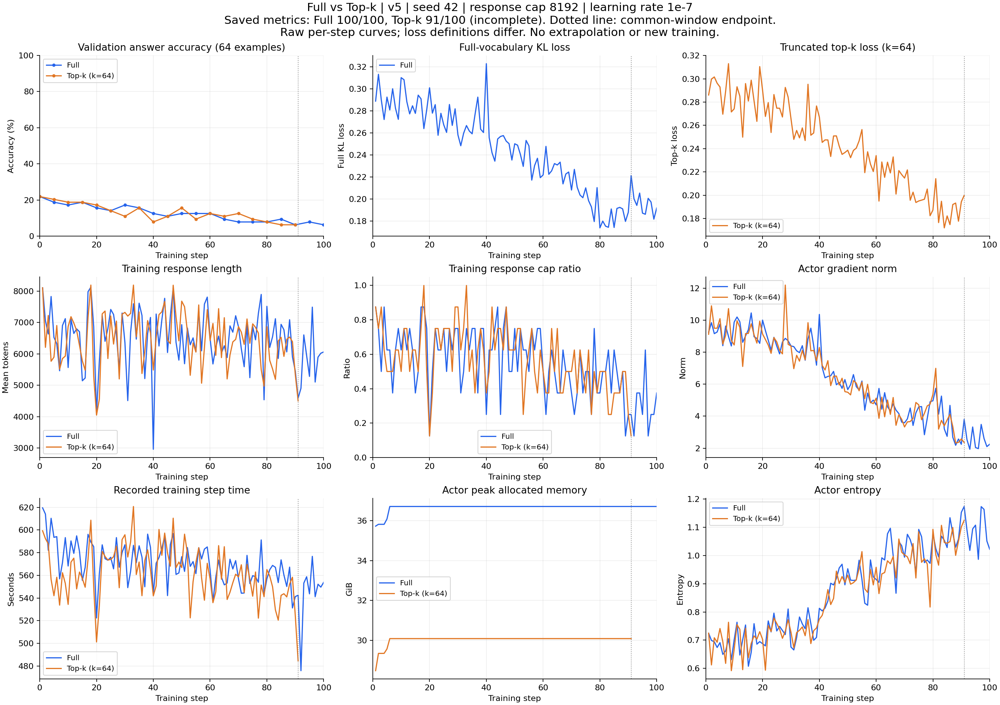

# Full and Top-k training results: v5

Exported from existing server logs on **2026-11-23 (Asia/Shanghai)**. Full has
100 completed training steps; Top-k has 91 of 100 planned steps, with validation
through step 90. **This is an incomplete pair, not a completed 100-step comparison.**
No training, inference, evaluation, or container startup was performed to produce
this report. Only saved scalar metrics were processed and plotted locally.



## Recorded results

| Metric | Full | Top-k (k=64) |
| --- | ---: | ---: |
| Completed training steps | 100 | 91 |
| Initial validation accuracy | 14/64 (21.875%) | 14/64 (21.875%) |
| Latest validation step | 100 | 90 |
| Latest validation accuracy | 4/64 (6.25%) | 4/64 (6.25%) |
| First recorded distillation loss | 0.288904 | 0.286093 |
| Last recorded distillation loss | 0.191977 | 0.199838 |
| Mean recorded step time, all completed steps (seconds) | 568.395 | 561.515 |
| Mean recorded step time, shared steps 1–91 (seconds) | 570.708 | 561.515 |
| Mean training response length, all completed steps (tokens) | 6470.396 | 6468.681 |
| Mean response cap ratio, all completed steps | 0.54625 | 0.57143 |
| Maximum recorded actor allocated memory (GiB) | 36.719 | 30.087 |

Both recorded latest validation accuracies are below their own baselines despite
declining training losses. Full does not meet the original requirement to improve
over its baseline. Top-k has no step-100 result in this snapshot; no final
100-versus-100 superiority or acceptance claim is made. Missing steps are not
filled, extrapolated, or replaced with data from earlier attempts.

## Configuration and interpretation

- Attempt **v5**, seed 42, learning rate `1e-7`, response cap 8192 tokens,
  `seq-mean-token-mean` loss aggregation, 64 validation examples, thinking disabled.
- Student: Qwen3.5-0.8B; teacher: Qwen3.5-35B-A3B; FSDP2 teacher and student.
  The recorded allocation is eight teacher devices plus eight student/rollout devices.
  Both runs start from the initial student checkpoint without resuming.
- Accuracy uses `val-core/hiyouga/geometry3k/acc/mean@1`. Training reward/score is
  preserved in the CSV but is **not** labeled as training answer accuracy.
  Counts in the validation CSV are derived from logged accuracy times 64;
  saved answers were not regraded during this export.
- Equal baseline aggregate accuracies do not prove identical baseline answers or
  image tensors. This export does not repeat the original sample-level audit.
- Full KL and truncated Top-k loss have different definitions; separate loss
  panels show each trajectory without treating their values as equivalent.
- Statistics are unweighted across completed steps, with population standard
  deviations. `statistics.csv` and `summary.json` include both each run's available
  interval and the shared interval 1–91. Validation metrics are separate.
- Recorded step time includes rollout and communication and is affected by
  response lengths. Its sum is not total job wall-clock time; startup and other
  work outside recorded step timers are excluded. These observations are not an
  isolated implementation speed benchmark.
- Memory is the actor allocator metric as logged, not total device, rollout, or
  teacher memory. Peak counters may retain previous high-water marks.
- Curves show unsmoothed recorded points. Lines connect observations; validation
  occurs only at the plotted checkpoints. The dotted line marks training step 91.
  A single seed and 64 validation examples do not establish general performance.

## Files and provenance

| File | Contents |
| --- | --- |
| [training_curves.png](training_curves.png), [training_curves.svg](training_curves.svg) | Nine panels: accuracy, separate losses, response length/cap ratio, gradient norm, time, memory, entropy |
| [metrics.csv](metrics.csv) | All logged numeric metrics by mode and step; blanks mean unobserved, not zero |
| [validation.csv](validation.csv) | Validation accuracy checkpoints and derived correct/total counts |
| [statistics.csv](statistics.csv) | Per-metric count, first/last, mean, median, population standard deviation, minimum and maximum |
| [summary.json](summary.json) | Machine-readable completeness, validation and statistical summaries |
| [full.metrics.txt](full.metrics.txt), [topk.metrics.txt](topk.metrics.txt) | Original saved complete metric lines, byte-for-byte unchanged |
| [run_manifest.json](run_manifest.json) | Original recorded configuration, package versions, dataset and source hashes |
| [provenance.json](provenance.json) | Metric/raw-source hashes, source locations, and source-code comparison results |
| [runner_status.txt](runner_status.txt) | Original runner log: Full exit 0 and Top-k start, without a Top-k completion record |
| [generate_report.py](generate_report.py) | Standalone local parser, statistics and plotting script |

The saved metrics match complete metric lines extracted from the downloaded raw
TaskRunner stdout for both runs. Their hashes match the server's metrics provenance.
All 31 manifest-listed repository source files match the published code snapshot
`4b5dc8502b12a3faf860b290cdfc862270ddb40a` after LF normalization. Runtime-only
orchestration files and model/dataset contents were not independently rehashed.
The original manifest identifies upstream base commit `909bb913`; the published
code commit additionally contains the then-uncommitted implementation.

Only metrics, metadata and this report are published here. Raw TaskRunner logs,
generated answers, credentials, model weights and datasets are excluded.
Historical v3/v4 attempts remain separate and are not mixed into v5 statistics.

To regenerate locally from this directory (no project imports or server access):

```sh
uv run --no-project --with matplotlib python generate_report.py
```

The generator verifies source hashes, finite metrics, contiguous recorded steps,
duplicate-value consistency, training-step fields, and validation counts before
writing CSV, JSON, PNG and SVG outputs. The exported charts were also visually
inspected. No training tests were run for this data-only publication.
